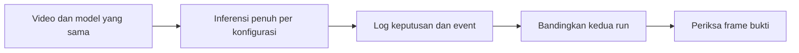

# Laporan Pengujian Overlap dan Event Disposal Run 1 dan Run 2

Tanggal pengujian: 3 November 2026. Acuan perilaku: `PRD - Disposal.docx` dan implementasi aturan pada `disposal/rules.py`.

Struktur folder dirapikan setelah pengujian. Path konfigurasi, kode, input, dan tautan dalam laporan ini mengikuti struktur terbaru; angka hasil mengacu pada log run yang sudah tersimpan di `outputs/`. Perintah pada laporan dijalankan dari root proyek.

## 1. Ringkasan hasil

Dua run menggunakan video, model, parameter deteksi, dan aturan yang sama. Perbedaannya adalah batas bawah area violation pada run 2 diturunkan 80 piksel. Masing-masing run memproses seluruh **2.707 frame**.

**Run 1 menghasilkan 0 event**, karena tidak ada evaluasi yang memenuhi seluruh syarat pelanggaran tanpa pengecualian. Sebanyak 43 evaluasi memiliki bbox sepenuhnya di area dan tidak terkena batas frame, tetapi semuanya terkena pengecualian overlap.

**Run 2 menghasilkan 28 event pada 19 track ID**, terdiri dari 16 event Truck HD dan 12 event Dozzer. Area yang lebih luas memungkinkan kendaraan yang terlihat utuh memenuhi aturan pelanggaran. Pengecualian overlap tetap aktif: pada contoh Truck HD ID 2, urutannya adalah `VIOLATION ? IGNORED_OCCLUDED ? VIOLATION`, dengan satu event sepanjang run untuk track tersebut.

Pemeriksaan log menunjukkan bbox, kelas, dan pasangan frame-track pada kedua run identik. Sebanyak 13.504 evaluasi berubah dari `OUTSIDE` menjadi `VIOLATION` karena perubahan polygon. Jumlah status pengecualian tidak berubah. Hasil ini mendukung kesesuaian logic overlap dan episode pada skenario yang diuji; hasil ini belum merupakan pengukuran akurasi deteksi dengan ground truth.

## 2. Tujuan dan cakupan pengujian

Pengujian dilakukan untuk memastikan:

1. Irisan bbox dengan luas positif memicu pengecualian overlap pada kedua kendaraan.
2. Bbox yang hanya bersentuhan pada garis atau titik tidak memenuhi pengecualian overlap.
3. Batas frame memiliki prioritas di atas overlap.
4. Kendaraan yang bbox-nya sepenuhnya masuk area tetap dikecualikan ketika overlap.
5. Event dicatat saat syarat `VIOLATION` terpenuhi dan tidak ditulis ulang pada setiap frame.
6. Pengecualian sementara tidak menghasilkan event duplikat saat kendaraan kembali terlihat normal dalam episode yang sama.
7. Perluasan area mengubah evaluasi posisi kendaraan tanpa mengubah aturan pengecualian.

Run 1 dan run 2 dalam laporan ini adalah pengujian video baru dengan model V8. Pengujian awal dengan model V7 dan video beresolusi 1920?1080 tidak termasuk dalam perbandingan ini.

## 3. Data dan lingkungan

| Komponen                               | Nilai                                                   |
| -------------------------------------- | ------------------------------------------------------- |
| Video                                  | `trim10.140.7.99_01_20261028085114778.mp4`              |
| Model                                  | `Vehicle_Detection_Disposal_CK_yolov8l_960_V8.pt`       |
| Resolusi sumber                        | 1280?960                                                |
| FPS sumber menurut OpenCV              | 24,9309265058                                           |
| Frame sumber menurut metadata          | 2.707                                                   |
| Frame diproses per run                 | 2.707                                                   |
| Perkiraan durasi dari jumlah frame/FPS | 108,58 detik                                            |
| Ukuran inferensi                       | 960                                                     |
| Perangkat                              | NVIDIA GeForce RTX 3050 Laptop GPU, `cuda:0`            |
| Confidence threshold                   | 0,25                                                    |
| Margin tepi frame                      | 2 piksel                                                |
| Batas kehilangan track                 | 30 frame                                                |
| Tracker                                | Pencocokan IoU kelas yang sama, ambang awal 0,2         |
| Target dan kelas penghalang            | Truck, Light Vehicle, Motorcycle, Bus, Truck HD, Dozzer |
| Kelas yang muncul dalam log keputusan  | Truck HD dan Dozzer                                     |
| Ekspor XLSX                            | Tidak diaktifkan                                        |

Versi lingkungan saat pemeriksaan: Python 3.10.6, OpenCV 5.0.0, PyTorch 2.14.0+cu126, Ultralytics 8.4.152, dan Shapely 2.1.2.

Nama `Dozzer` mengikuti nama kelas yang tersimpan pada model. Waktu pada laporan menggunakan `frame_index / FPS` sumber, dengan indeks frame pertama 0. FPS sumber dibaca dari metadata OpenCV; sifat constant/variable frame rate tidak diuji terpisah.

## 4. Konfigurasi area

### 4.1 Main area yang digunakan pada kedua run

```json
[[1, 958], [1279, 959], [1279, 1], [1, 2]]
```

Pada implementasi saat ini, `main_area` digambar sebagai polygon pembantu pada video. Polygon ini tidak membatasi input detektor atau menentukan keputusan pelanggaran. Keputusan menggunakan `violation_area`.

### 4.2 Run 1 dengan area awal

Konfigurasi: [config_overlap_v8.json](../configs/config_overlap_v8.json).

```json
[[1279, 672], [6, 532], [5, 0], [1278, 5]]
```

Input awal memuat titik `[1278, 5]` dua kali berturut-turut. Satu duplikat dihapus agar lolos validasi titik berbeda; bentuk polygon dipertahankan.

### 4.3 Run 2 dengan area diperluas

Konfigurasi: [config_overlap_v8_expanded.json](../configs/config_overlap_v8_expanded.json).

```json
[[1279, 752], [6, 612], [5, 0], [1278, 5]]
```

Dua titik pembentuk batas bawah diubah: `[1279, 672] ? [1279, 752]` dan `[6, 532] ? [6, 612]`. Koordinat Y yang lebih besar berarti posisi lebih ke bawah pada gambar. Dua titik atas dan parameter lainnya tetap sama.

## 5. Aturan yang diperiksa

### 5.1 Masuk area

Seluruh polygon bbox harus dicakup polygon violation, termasuk jika menyentuh batas dari sisi dalam. Hanya titik tengah di dalam atau overlap sebagian belum cukup.

```python
shape = box(x1, y1, x2, y2)
coverage = min(1.0, max(0.0, polygon.intersection(shape).area / shape.area))
inside = polygon.covers(shape)
```

`coverage_ratio` memakai luas bbox sebagai penyebut. Nilai ini berbeda dari IoU tracker, yang memakai luas gabungan dua bbox.

### 5.2 Overlap kendaraan

```python
occluded = any(
    other is not detection and
    max(x1, other.bbox[0]) < min(x2, other.bbox[2]) and
    max(y1, other.bbox[1]) < min(y2, other.bbox[3])
    for other in detections
)
```

Rentang X dan Y harus sama-sama beririsan dengan panjang positif. Tidak ada ambang persentase atau luas minimum selain lebih dari nol. Penggunaan `<` membuat sentuhan garis/titik tanpa luas tidak dianggap overlap. Setiap kendaraan dievaluasi sendiri, sehingga kedua bbox yang overlap mendapatkan flag `occluded`.

Urutan keputusan adalah `IGNORED_TRUNCATED ? IGNORED_OCCLUDED ? OUTSIDE ? VIOLATION`. Akibatnya, bbox yang overlap sekaligus menyentuh batas frame tetap berstatus `IGNORED_TRUNCATED`, sementara flag `occluded` tetap bernilai benar.

### 5.3 Episode dan event

Satu episode adalah rangkaian track yang berada sepenuhnya di dalam area. Event pertama dicatat pada frame pertama yang memenuhi `VIOLATION`. Pengecualian sementara mempertahankan episode selama belum ada deteksi aktual yang menunjukkan bbox tidak sepenuhnya di dalam. Deteksi aktual yang keluar mengakhiri episode; masuk kembali dapat menghasilkan event baru. Kehilangan deteksi saja tidak membuktikan kendaraan keluar, dan state dibuang saat track kedaluwarsa.

Tidak ada minimum durasi atau toleransi keluar-masuk dalam aturan saat ini. Kendaraan yang pertama terdeteksi sudah di dalam dapat langsung menghasilkan event. Karena itu, event pada frame 0 diperbolehkan oleh PRD.

## 6. Metode pemeriksaan



Kedua run memanggil pipeline `main.process()` dengan kode aplikasi yang sama. Instrumentasi sementara mencatat hasil keputusan per frame ke `decisions.csv` serta pasangan overlap dan luas irisannya. Instrumentasi meneruskan hasil `evaluate()` tanpa mengubah keputusan. Tidak ada perubahan kode sumber aplikasi `.py` untuk dua run ini; file yang ditambahkan berupa konfigurasi dan artefak pengujian.

Pemeriksaan meliputi:

- Membaca `summary.json`, `violations.csv`, `decisions.csv`, dan `overlap_validation.json`.
- Mencocokkan semua pasangan `(frame_index, track_id)`, kelas, dan koordinat bbox antar-run.
- Memeriksa kesesuaian status dengan flag overlap dan batas frame, termasuk simetri flag pada pasangan kendaraan.
- Mencocokkan setiap event CSV dengan keputusan pada frame dan track terkait.
- Memutar ulang keputusan yang tersimpan melalui `Episodes.update()`; urutan pasangan frame-track event yang terbentuk cocok dengan CSV kedua run.
- Pada run 1, mengevaluasi ulang bbox yang sama tanpa kendaraan penghalang untuk memastikan pengecualian overlap memang menahan keputusan yang seharusnya memenuhi `VIOLATION`.
- Memeriksa cuplikan frame terpilih dan membuat demo singkat event-overlap untuk run 2.

Tiga unit test pada `tests/test_rules.py` lulus. Pemeriksaan tambahan dengan bbox buatan juga lulus untuk overlap positif pada kedua bbox, sentuhan garis, dan prioritas batas frame. Pemeriksaan ini bukan bukti bahwa seluruh kriteria penerimaan PRD telah diuji menyeluruh.

## 7. Perbandingan hasil utama

Satu evaluasi berarti satu kendaraan pada satu frame. Angka evaluasi tidak boleh dibaca sebagai jumlah kendaraan atau event.

| Metrik                                    | Run 1: area awal | Run 2: area turun 80 piksel |
| ----------------------------------------- | ---------------: | --------------------------: |
| Status akhir                              |        completed |                   completed |
| Frame diproses                            |            2.707 |                       2.707 |
| Evaluasi kendaraan                        |           19.998 |                      19.998 |
| Track ID teramati                         |               67 |                          67 |
| `VIOLATION`                               |                0 |                      13.504 |
| `OUTSIDE`                                 |           15.395 |                       1.891 |
| `IGNORED_OCCLUDED`                        |            2.071 |                       2.071 |
| `IGNORED_TRUNCATED`                       |            2.532 |                       2.532 |
| Event CSV                                 |                0 |                          28 |
| Track ID yang menghasilkan event          |                0 |                          19 |
| Frame dengan sedikitnya satu flag overlap |              939 |                         939 |
| Evaluasi dengan flag overlap              |            2.395 |                       2.395 |
| Overlap sekaligus batas frame             |              324 |                         324 |
| Durasi pemrosesan menurut summary         |    229,625 detik |               233,547 detik |
| FPS pemrosesan                            |           11,789 |                      11,591 |

Dari 2.395 evaluasi yang memiliki flag overlap, 2.071 berstatus `IGNORED_OCCLUDED` dan 324 berstatus `IGNORED_TRUNCATED`. Angka ini menghitung masing-masing kendaraan pada tiap frame, bukan jumlah pasangan overlap. Sebanyak 939 frame memiliki setidaknya satu kendaraan dengan overlap.

Bbox, kelas, dan kunci frame-track identik pada seluruh 19.998 evaluasi kedua run. Satu-satunya perubahan status yang ditemukan adalah **13.504 `OUTSIDE ? VIOLATION`**. Ini menunjukkan hasil perbandingan tidak tercampur oleh perbedaan deteksi pada kedua run tersebut.

Durasi/FPS diambil dari penghitung reporter setelah inisialisasi model dan mencakup loop pemrosesan beserta pencatatan diagnostik. Angka ini bukan durasi total proses dari awal pemuatan model dan bukan benchmark performa yang dikontrol. Kedua run lebih lambat daripada FPS media sekitar 24,93; PRD tidak mewajibkan real-time.

### 7.1 Evaluasi menurut kelas

| Kelas    | Status            |  Run 1 |  Run 2 |
| -------- | ----------------- | -----: | -----: |
| Truck HD | VIOLATION         |      0 |  3.398 |
| Truck HD | OUTSIDE           |  3.844 |    446 |
| Truck HD | IGNORED_OCCLUDED  |  1.209 |  1.209 |
| Truck HD | IGNORED_TRUNCATED |  1.657 |  1.657 |
| Dozzer   | VIOLATION         |      0 | 10.106 |
| Dozzer   | OUTSIDE           | 11.551 |  1.445 |
| Dozzer   | IGNORED_OCCLUDED  |    862 |    862 |
| Dozzer   | IGNORED_TRUNCATED |    875 |    875 |

## 8. Analisis run 1

Area awal belum mencakup seluruh bbox kendaraan pada sebagian besar frame. Semua 15.395 evaluasi tanpa pengecualian berstatus `OUTSIDE`.

Ada **43 evaluasi** dengan bbox sepenuhnya di dalam area dan tidak menyentuh batas frame: 30 Truck HD dan 13 Dozzer. Seluruhnya berstatus `IGNORED_OCCLUDED`. Ketika bbox yang sama dievaluasi tanpa penghalang, seluruh 43 evaluasi menjadi `VIOLATION`. Pemeriksaan ini membuktikan bahwa pada sampel tersebut pengecualian overlap benar-benar menahan keputusan pelanggaran, bukan sekadar kebetulan tidak ada event karena bbox di luar area.

Angka 43 merupakan evaluasi per frame, bukan 43 calon event atau 43 kendaraan. Tidak ada baris event pada CSV run 1, tetapi header laporan tetap tersedia.

Pasangan Truck HD ID 2 dan 26 overlap terus-menerus selama **80 frame**, dari frame 1668 hingga 1747, atau sekitar **66,905?70,074 detik**. Pada frame 1708, luas irisan kedua bbox sekitar **599,798 piksel persegi** dan keduanya berstatus `IGNORED_OCCLUDED`.

[Cuplikan run 1 pada frame 1708](../outputs/overlap_v8_20261103_131410/frame_1708.jpg):


## 9. Analisis run 2

Perluasan area menghasilkan **13.504 evaluasi `VIOLATION`**, yang dirangkum menjadi **28 event**: 16 Truck HD dan 12 Dozzer. Event berasal dari 19 track ID, yaitu 8 track Truck HD dan 11 track Dozzer. Track ID ini belum setara dengan jumlah kendaraan fisik karena kualitas pelacakan tidak dievaluasi dengan ground truth.

Terdapat **14.904 evaluasi** dengan bbox sepenuhnya di dalam dan tanpa pengecualian batas frame. Sebanyak 13.504 menjadi `VIOLATION`; **1.400 tetap `IGNORED_OCCLUDED`**. Artinya, area yang diperluas tidak menghilangkan pengecualian overlap.

Seluruh 28 event ditelusuri ke baris keputusan yang berstatus `VIOLATION`, tanpa flag overlap maupun batas frame. Tidak ditemukan event baru saat pengecualian aktif dalam pemeriksaan ini.

### 9.1 Bukti episode Truck HD ID 2

| Frame | Waktu media (detik) | Run 1 | Run 2 | Event baru ID 2 di run 2 |
| ---: | ---: | --- | --- | --- |
| 92 | 3,690 | OUTSIDE | VIOLATION | Ya, event pertama |
| 1667 | 66,865 | OUTSIDE | VIOLATION | Tidak, episode masih aktif |
| 1708 | 68,509 | IGNORED_OCCLUDED | IGNORED_OCCLUDED | Tidak, pengecualian aktif |
| 1748 | 70,114 | OUTSIDE | VIOLATION | Tidak, episode yang sama dilanjutkan |

Pada frame 1708 run 2, **ID 2 dan ID 26 sama-sama memiliki coverage 1,0**, tetapi keduanya tetap `IGNORED_OCCLUDED` karena bbox overlap. Setelah overlap ID 2 dan ID 26 berakhir, ID 2 kembali `VIOLATION` tanpa menambah event. Total event ID 2 sepanjang run tetap **satu** pada frame 92. ID 26 masih dapat berstatus `IGNORED_OCCLUDED` karena overlap dengan kendaraan lain; statusnya tidak hanya bergantung pada pasangan dengan ID 2.

Demo merangkai dua bagian video sumber: frame 70?119 untuk event pertama dan frame 1640?1789 untuk kondisi sebelum, selama, dan sesudah overlap. Durasi demo sekitar 8 detik; ini bukan rentang waktu sumber yang kontinu. Banner tambahan pada demo dan tiga cuplikan menampilkan status serta catatan event track ID 2 dari log.

- [Demo event dan overlap](../outputs/overlap_v8_expanded_20261103_143646/demo_event_overlap.mp4).
- [Event pertama pada frame 92](../outputs/overlap_v8_expanded_20261103_143646/event_92.jpg).
- [Overlap pada frame 1708](../outputs/overlap_v8_expanded_20261103_143646/overlap_1708.jpg).
- [Sesudah overlap pada frame 1748](../outputs/overlap_v8_expanded_20261103_143646/sesudah_1748.jpg).


### 9.2 Distribusi event per track

| Kelas | Track ID | Jumlah event |
| --- | ---: | ---: |
| Dozzer | 1 | 1 |
| Dozzer | 4 | 1 |
| Dozzer | 5 | 1 |
| Dozzer | 6 | 1 |
| Dozzer | 9 | 1 |
| Dozzer | 11 | 2 |
| Dozzer | 12 | 1 |
| Dozzer | 15 | 1 |
| Dozzer | 37 | 1 |
| Dozzer | 44 | 1 |
| Dozzer | 48 | 1 |
| Truck HD | 2 | 1 |
| Truck HD | 16 | 1 |
| Truck HD | 26 | 8 |
| Truck HD | 36 | 1 |
| Truck HD | 47 | 1 |
| Truck HD | 50 | 1 |
| Truck HD | 56 | 2 |
| Truck HD | 60 | 1 |

Sebagian besar track memiliki satu event. ID 11 memiliki dua event, ID 26 delapan event, dan ID 56 dua event. Setiap event ulang tersebut mengikuti deteksi aktual dengan bbox yang tidak lagi sepenuhnya di dalam area di antara event terkait.

### 9.3 Catatan event berulang di dekat batas polygon

Pada Dozzer ID 11, event muncul pada frame 324 dan 328. Frame 325?327 berstatus `OUTSIDE`, dengan coverage sekitar 0,9979?0,9987. Walaupun bagian bbox yang keluar sangat kecil, aturan containment penuh mengakhiri episode, sehingga event kedua tercatat sekitar 0,16 detik setelah event pertama.

Truck HD ID 26 mencatat lima event berdekatan pada detik 42,437; 42,638; 43,079; 43,239; dan 43,560. Di antara event itu terdapat deteksi `OUTSIDE`, termasuk coverage sekitar 0,9708 dan 0,9652. Event selanjutnya untuk ID 26 juga memiliki bukti bbox tidak sepenuhnya di dalam, sebagian saat pengecualian aktif. ID 56 juga memiliki deteksi bbox keluar sebelum event ulang.

Secara algoritme, pencatatan ini sesuai PRD yang menyelesaikan episode saat bbox aktual tidak sepenuhnya di dalam. Secara operasional, event yang berdekatan **dapat mencerminkan jitter bbox atau perpindahan nyata**; penentuan penyebabnya memerlukan peninjauan video dan acuan dari pemilik data. Karena itu, 28 event tidak boleh disimpulkan sebagai 28 kendaraan atau 28 kejadian operasional berbeda yang sudah terverifikasi manusia.

## 10. Daftar lengkap event run 2

Seluruh baris memiliki `status = VIOLATION`, `reason = FULL_BBOX_INSIDE`, dan coverage 1,0 pada CSV. Confidence di tabel dibulatkan tiga angka desimal; nilai CSV tetap menjadi sumber rinci.

| No. | Frame | Waktu media (detik) | Track ID | Kelas | Confidence |
| ---: | ---: | ---: | ---: | --- | ---: |
| 1 | 0 | 0.000 | 1 | Dozzer | 0.848 |
| 2 | 0 | 0.000 | 4 | Dozzer | 0.807 |
| 3 | 0 | 0.000 | 5 | Dozzer | 0.485 |
| 4 | 68 | 2.728 | 6 | Dozzer | 0.744 |
| 5 | 92 | 3.690 | 2 | Truck HD | 0.812 |
| 6 | 140 | 5.616 | 9 | Dozzer | 0.307 |
| 7 | 292 | 11.712 | 12 | Dozzer | 0.705 |
| 8 | 324 | 12.996 | 11 | Dozzer | 0.650 |
| 9 | 328 | 13.156 | 11 | Dozzer | 0.525 |
| 10 | 446 | 17.889 | 15 | Dozzer | 0.283 |
| 11 | 458 | 18.371 | 16 | Truck HD | 0.332 |
| 12 | 1058 | 42.437 | 26 | Truck HD | 0.722 |
| 13 | 1063 | 42.638 | 26 | Truck HD | 0.696 |
| 14 | 1074 | 43.079 | 26 | Truck HD | 0.547 |
| 15 | 1078 | 43.239 | 26 | Truck HD | 0.655 |
| 16 | 1086 | 43.560 | 26 | Truck HD | 0.632 |
| 17 | 1426 | 57.198 | 26 | Truck HD | 0.314 |
| 18 | 1508 | 60.487 | 36 | Truck HD | 0.403 |
| 19 | 1510 | 60.567 | 37 | Dozzer | 0.261 |
| 20 | 1617 | 64.859 | 26 | Truck HD | 0.855 |
| 21 | 1815 | 72.801 | 44 | Dozzer | 0.843 |
| 22 | 1900 | 76.211 | 47 | Truck HD | 0.284 |
| 23 | 1959 | 78.577 | 48 | Dozzer | 0.623 |
| 24 | 2125 | 85.236 | 50 | Truck HD | 0.712 |
| 25 | 2171 | 87.081 | 26 | Truck HD | 0.831 |
| 26 | 2254 | 90.410 | 56 | Truck HD | 0.559 |
| 27 | 2540 | 101.881 | 56 | Truck HD | 0.320 |
| 28 | 2596 | 104.128 | 60 | Truck HD | 0.864 |

## 11. Batas interpretasi

- Overlap bbox adalah indikator potensi occlusion. Sistem belum menentukan kendaraan depan/belakang dan mengecualikan kedua kendaraan, termasuk ketika keduanya masih terlihat sebagian.
- Irisan sangat kecil sudah memenuhi aturan. Overlap perspektif atau deteksi ganda juga dapat memicu pengecualian meskipun tidak mencerminkan kendaraan benar-benar tertutup.
- Tracker menggunakan IoU sederhana. Pergantian ID dapat memicu episode/event baru untuk kendaraan fisik yang sama; 67 track ID teramati bukan bukti ada 67 kendaraan fisik.
- Tidak ada minimum durasi pelanggaran atau toleransi keluar-masuk, sehingga perubahan kecil bbox di batas polygon dapat memecah episode.
- Video memiliki visibilitas yang terbatas pada cuplikan yang diperiksa. Kualitas deteksi dan klasifikasi tetap memengaruhi bbox serta overlap yang dapat dievaluasi.
- Pemeriksaan visual dilakukan pada frame terpilih, sedangkan pemeriksaan log mencakup seluruh evaluasi. Belum tersedia label ground truth untuk mengukur precision, recall, atau akurasi occlusion.
- Hasil dua run ini memvalidasi perilaku pada satu video dan satu model; belum membuktikan generalisasi ke kamera atau kondisi lain.

Jika event yang terlalu berdekatan dianggap tidak sesuai kebutuhan operasional, langkah berikutnya adalah meninjau cuplikan tersebut bersama pemilik data dan menyepakati kebijakan toleransi/durasi. Perubahan itu akan mengubah aturan episode dan belum diterapkan dalam dua run ini.

## 12. Artefak dan cara menjalankan ulang

| Artefak | Run 1 | Run 2 |
| --- | --- | --- |
| Konfigurasi | [config](../configs/config_overlap_v8.json) | [config](../configs/config_overlap_v8_expanded.json) |
| Video penuh | [annotated.mp4](../outputs/overlap_v8_20261103_131410/annotated.mp4) | [annotated.mp4](../outputs/overlap_v8_expanded_20261103_143646/annotated.mp4) |
| Event CSV | [violations.csv](../outputs/overlap_v8_20261103_131410/violations.csv) | [violations.csv](../outputs/overlap_v8_expanded_20261103_143646/violations.csv) |
| Keputusan per frame | [decisions.csv](../outputs/overlap_v8_20261103_131410/decisions.csv) | [decisions.csv](../outputs/overlap_v8_expanded_20261103_143646/decisions.csv) |
| Ringkasan run | [summary.json](../outputs/overlap_v8_20261103_131410/summary.json) | [summary.json](../outputs/overlap_v8_expanded_20261103_143646/summary.json) |
| Pemeriksaan overlap | [overlap_validation.json](../outputs/overlap_v8_20261103_131410/overlap_validation.json) | [overlap_validation.json](../outputs/overlap_v8_expanded_20261103_143646/overlap_validation.json) |
| Konfigurasi efektif | [config_used.json](../outputs/overlap_v8_20261103_131410/config_used.json) | [config_used.json](../outputs/overlap_v8_expanded_20261103_143646/config_used.json) |

Perintah berikut menjalankan pipeline utama dengan konfigurasi yang sama. Gunakan folder output baru. Perintah ini menghasilkan keluaran standar PRD; `decisions.csv`, `overlap_validation.json`, banner bukti, dan demo merupakan artefak diagnostik tambahan dari sesi pengujian, sehingga tidak otomatis dibuat oleh CLI standar.

```powershell
# Run 1: area awal
python main.py --video assets/videos/trim10.140.7.99_01_20261028085114778.mp4 --model assets/models/Vehicle_Detection_Disposal_CK_yolov8l_960_V8.pt --config configs/config_overlap_v8.json --output outputs/run_1_ulang

# Run 2: area diperluas
python main.py --video assets/videos/trim10.140.7.99_01_20261028085114778.mp4 --model assets/models/Vehicle_Detection_Disposal_CK_yolov8l_960_V8.pt --config configs/config_overlap_v8_expanded.json --output outputs/run_2_ulang
```

Input video dan model, serta folder `outputs/`, dikecualikan oleh `.gitignore` proyek. Jika laporan disalin atau dibagikan, sertakan artefak terkait agar tautan relatif di atas tetap dapat dibuka.

## 13. Identitas input

SHA-256 berikut dihitung dari file lokal saat penyusunan laporan untuk membantu mencocokkan aset pengujian.

| Input | Ukuran file (byte) | SHA-256 |
| --- | ---: | --- |
| Video | 4.994.720 | `da0c0c65cacc26f0b6435fb2d98b0858c99b662da6e945d3717de54efc713105` |
| Model | 87.703.219 | `a097584f07f07862f3b2a5407eca4886a235b964951efda9e2a89e7d78aeeb88` |
